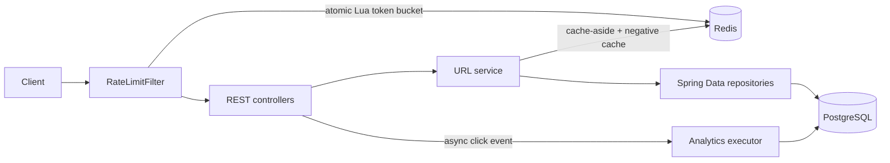

# Rate-Limited URL Shortener

A Java 17 / Spring Boot 3 service that turns long HTTP(S) URLs into short links and redirects visitors. It uses PostgreSQL for durable URL and click data, Redis for cache-aside lookups and atomic rate limits, and asynchronous click recording.

## Start locally

```bash
docker compose up --build
```

The API is at `http://localhost:8080`; Swagger UI is at `/swagger-ui.html`. PostgreSQL and Redis are exposed on their default ports for local development. Set `PREMIUM_API_KEY` before starting to enable the premium tier. Requests with any other key remain in the free tier and are still keyed separately for rate limiting.

```bash
curl -i -X POST http://localhost:8080/api/v1/urls \
  -H 'Content-Type: application/json' \
  -d '{"url":"https://example.com/a/long/path","customAlias":"docs","expiresAt":"2027-01-01T00:00:00Z"}'
curl -i http://localhost:8080/docs
curl http://localhost:8080/api/v1/urls/docs/stats
```

Create requests return `201`; alias collisions return `409`. Redirects return `302`, unknown codes return `404`, and expired links return `410`. The API applies `429` with `Retry-After` and `X-RateLimit-*` headers when a bucket is empty.

## Architecture



The application is organized into controller, service, repository, code-generation, rate-limit, configuration, and exception-handling packages. PostgreSQL enforces uniqueness on `short_code`, including across concurrent alias requests. The default Base62 counter is allocated through Redis; `random-with-retry` and `hash-based` are selectable alternatives. Choose with `CODE_GENERATOR=base62-counter|random-with-retry|hash-based`. Rate limiter strategies are selectable with `RATE_LIMITER=token-bucket|fixed-window|sliding-window`.

Base62 has 62 symbols; seven characters represent `62^7 = 3,521,614,606,208` possible values. Counter-generated codes can grow beyond seven characters as the sequence grows.

## Rate limits and cache

Free clients have a burst of 10 create requests at 1 token/second and a burst of 120 redirects at 10 tokens/second. A configured premium API key receives a burst of 60 at 10 tokens/second on both endpoint classes. Limits are keyed by endpoint, tier, and API key or remote client address. Redis Lua updates token count and timestamp atomically across app instances. Set `PREMIUM_API_KEY` to a secret value; do not expose it in source control.

Redirect lookups cache the target URL and expiry for ten minutes. Misses are cached for 30 seconds. Expiry is checked at redirect time even for cached records. Click events are written on a bounded asynchronous executor; the stats endpoint returns event count and last access time.

Only absolute HTTP/HTTPS destinations are accepted. Localhost, local domains, and addresses resolved to private, loopback, link-local, or multicast IPs are rejected. This validation is intended to reduce abuse; deployments should also apply network egress controls.

## Tests and performance

Run `mvn verify` to execute unit tests and Testcontainers integration/concurrency tests. Docker must be available. The concurrency test submits parallel requests to a fresh Redis bucket and asserts that exactly its configured capacity is admitted.

Run the sample k6 workload after creating a known short code:

```bash
k6 run -e BASE_URL=http://localhost:8080 -e SHORT_CODE=docs benchmarks/k6.js
```

The script reports throughput and latency percentiles and sets p95/p99 thresholds. To compare cache behavior, run once with Redis warm, then clear the `url:*` keys and repeat; inspect Redis hit/miss metrics or add application counters before drawing conclusions. **No benchmark has been run for this repository yet**, so no measured RPS, p95/p99, or hit ratio is claimed. The sub-20 ms p95 target depends on deployment, cache warmth, and network location.

## Configuration

| Variable | Default | Purpose |
|---|---|---|
| `DATABASE_URL` | `jdbc:postgresql://localhost:5432/shortener` | JDBC URL |
| `DATABASE_USER` / `DATABASE_PASSWORD` | `shortener` / `shortener` | PostgreSQL credentials |
| `REDIS_HOST` / `REDIS_PORT` | `localhost` / `6379` | Redis connection |
| `PREMIUM_API_KEY` | empty | Enables one premium API key |
| `CODE_GENERATOR` | `base62-counter` | Generator strategy |
| `RATE_LIMITER` | `token-bucket` | Limiter strategy |
| `SHORTENER_BASE_URL` | `http://localhost:8080` | Host used in create responses |

Hibernate schema update is enabled for this starter. For production, replace it with versioned database migrations, use managed secrets, and monitor the async queue and Redis availability.
